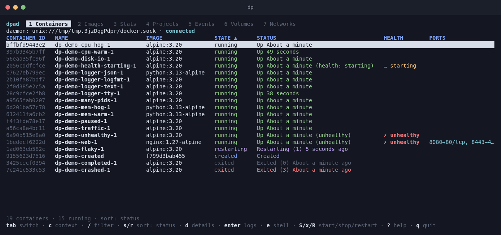
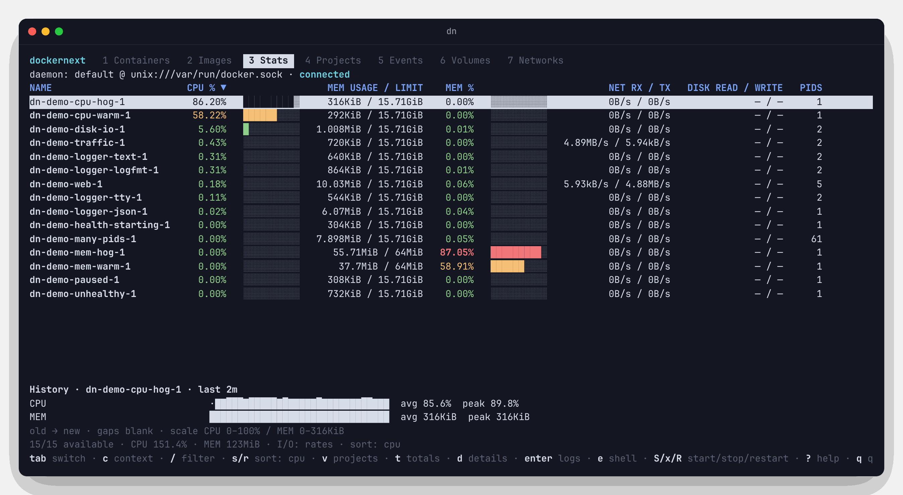
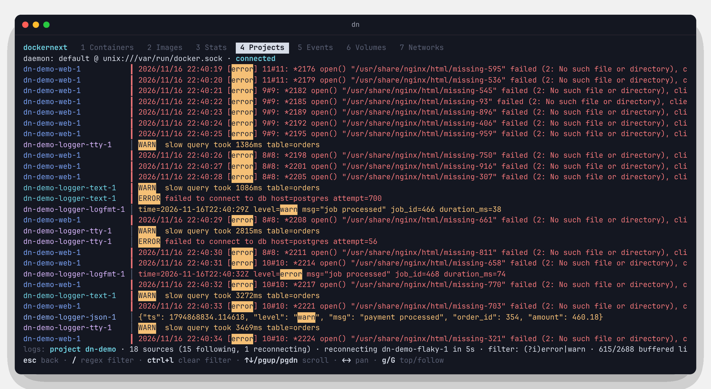
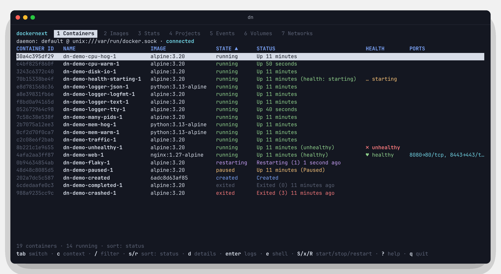
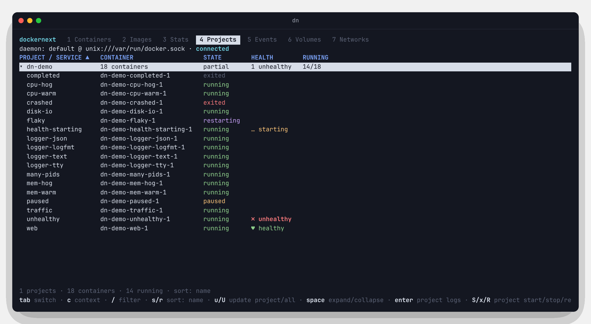
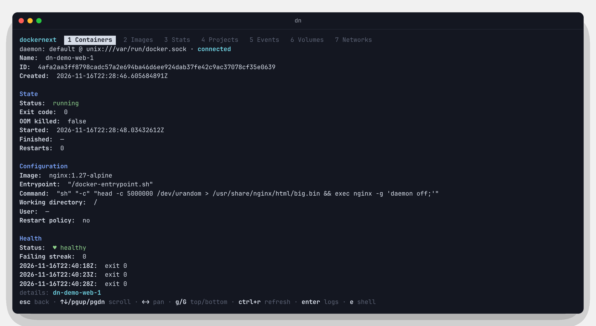
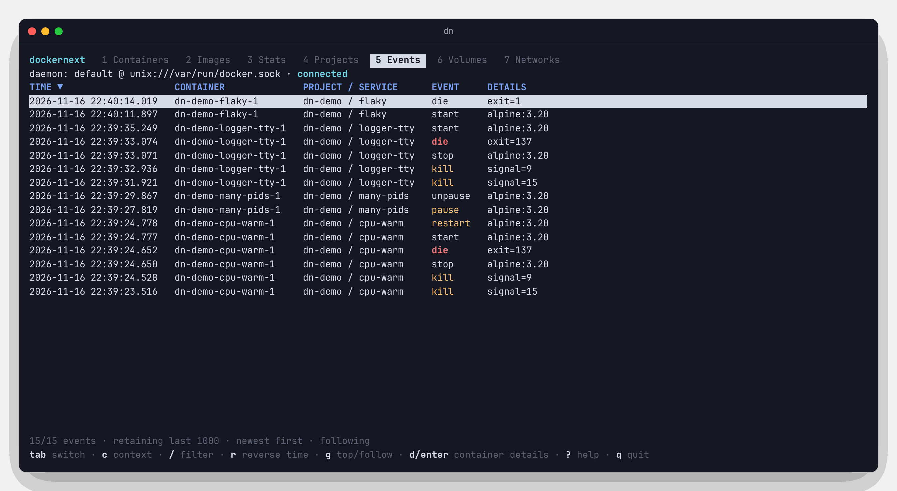
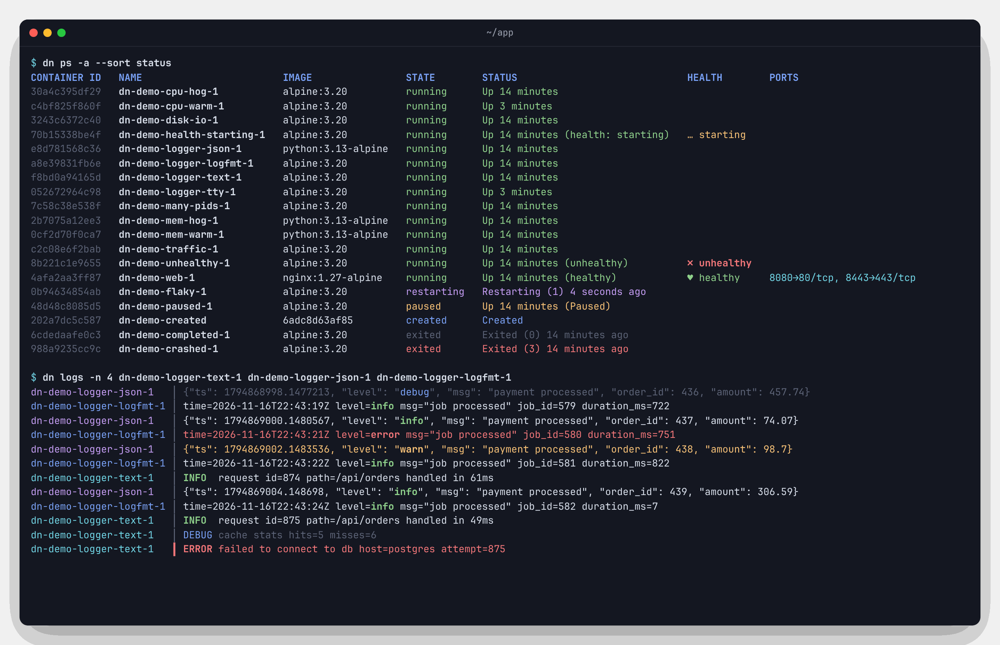

<div align="center">

# dockernext

### A colorful, interactive companion to the `docker` CLI

`dn` adds live stats with sparklines, multi-container logs, Compose project controls<br>
and a full-screen terminal UI. Anything it doesn't enhance goes straight to `docker`.

[](https://github.com/spar/dockernext/actions/workflows/ci.yml)


[](https://github.com/charmbracelet/bubbletea)

**[Quick start](#quick-start) · [Features](#features) · [Performance](#performance) · [Commands](#commands) · [Docs](#documentation)**



</div>

## Why dn

`docker ps` and `docker stats` are fine for a quick look. Once you run more than
a handful of containers, you start piping through `grep`, opening one terminal
per `docker logs -f`, and re-running commands to see what changed. `dn` keeps
the commands you already know and fills those gaps:

| | `docker` | `dn` |
|---|:---:|:---:|
| Colored container states and a health column | | ✓ |
| Sort `ps`, `images` and `stats` by any column | | ✓ |
| CPU and memory bars, plus two-minute sparklines | | ✓ |
| Network and disk throughput per second | totals only | ✓ |
| Logs from several containers interleaved, with level highlighting | one container¹ | ✓ |
| Regex filter over buffered logs, with match highlighting | | ✓ |
| Compose projects: grouped stats, project logs, start/stop/restart, image updates | per project dir¹ | ✓ |
| Events timeline, volume and network usage, container shells | separate commands | ✓ in one UI |
| Every other command and flag | ✓ | ✓ passed through |

<sub>¹ `docker compose logs` and `docker compose up` cover one project at a time, from its directory.</sub>

`dn` talks to the Docker Engine API directly and uses your existing contexts and
`DOCKER_HOST`. Switching contexts inside `dn` does not change the Docker CLI's
saved current context.

## Quick start

You need **Go 1.26.7+** and a running Docker engine (Docker Desktop, colima,
OrbStack, or Docker on Linux). The `docker` CLI is used for passthrough commands.

```bash
git clone https://github.com/spar/dockernext.git
cd dockernext
make install
```

This builds a static binary and installs `dockernext` plus a short `dn` symlink
into `~/.local/bin`. Then:

```bash
dn                    # full-screen TUI
dn ps -a              # colored, sortable ps
dn stats --sort mem   # live stats, biggest memory users first
dn logs -f api worker # several containers, one stream
```

Want something to look at? `make demo-up` starts about 20 demo containers that
exercise every feature (busy CPUs, memory near its limit, health checks,
crash loops, JSON and logfmt logs). `make demo-down` removes them.

Windows (WSL2 or Git Bash), shell completion, other install locations and
troubleshooting are covered in [Running locally](docs/local-development.md).

## Features

### Live stats you can sort and read at a glance



- CPU and memory bars that turn yellow and red as usage climbs.
- Network RX/TX and disk read/write as **rates per second**; press `t` for cumulative totals.
- Sort by CPU, memory, network, disk, PIDs or name with `s`, reverse with `r`.
- CPU and memory **sparklines** for the selected container, with average and peak over the last two minutes.
- Compose projects collapse into one summary row (`v` toggles the flat view).
- Streams that stall or drop reconnect on their own; stale values show `—` instead of old numbers.

### Logs from a whole project in one stream



- Follow one container, several (`dn logs a b c`), or a whole Compose project (`enter` on a project row).
- Every container gets a stable color; stderr lines are marked with `┃`.
- Log levels are highlighted in plain text, JSON, logfmt and nginx formats.
- Press `/` to filter by regular expression. Matches are highlighted and new lines are filtered as they arrive.
- Project logs follow containers as they are scaled, recreated or restarted, and resume from the last timestamp after a reconnect.

### Everything else in one place

<table>
  <tr>
    <td width="50%" valign="top">
      <br>
      <b>Containers</b><br>
      <sub>States, health and ports in color. Start, stop and restart with a confirmation; <code>e</code> opens a shell.</sub>
    </td>
    <td width="50%" valign="top">
      <br>
      <b>Compose projects</b><br>
      <sub>Grouped by project and service, with running and unhealthy counts. <code>u</code> previews and runs <code>pull</code> + <code>up -d</code>.</sub>
    </td>
  </tr>
  <tr>
    <td width="50%" valign="top">
      <br>
      <b>Details</b><br>
      <sub>State, exit code, OOM status, restart policy, health checks, ports, networks and mounts. Environment variables are left out.</sub>
    </td>
    <td width="50%" valign="top">
      <br>
      <b>Events</b><br>
      <sub>A live timeline of lifecycle and health events, filterable by container, project, service or event type.</sub>
    </td>
  </tr>
</table>

The **Images**, **Volumes** and **Networks** tabs show which containers, running
or stopped, use each image, volume or network. Press `c` to switch to another
Docker context for the current session.

### A better `docker` for everyday commands



The CLI commands keep Docker's flags and add sorting and color. Output stays plain
when piped, when `NO_COLOR` is set, or with `--no-color`, so scripts keep working.

### Remote daemons over SSH

```bash
DOCKER_HOST=ssh://me@server dn
```

`dn` opens one SSH tunnel to the remote socket and draws the UI locally, so
moving through lists doesn't wait on the network. Your `~/.ssh/config`, agent and
known hosts apply, rootless sockets work (`ssh://me@server/run/user/1000/docker.sock`),
and dropped connections reconnect in the background. Details are in
[Daemon connection](docs/usage.md#daemon-connection).

<sub>All screenshots are real, unedited output from the bundled demo environment (`make demo-up`).</sub>

## Performance

`dn` is built to stay responsive with hundreds of containers and to cost little
while it sits open in a terminal tab.

**How it stays light**

- One Docker event subscription drives the container lists, Projects and the Events timeline. Bursts of events are coalesced into at most one list refresh per second.
- Stats updates are batched before redrawing. Project grouping, rates and sparklines are computed from the same stream and add no Docker requests.
- Buffers have fixed limits: 5,000 log lines, 1,000 events, and 120 one-second history buckets (about 6 KiB) per container.
- The TUI renders at up to 120 frames per second, and frames that haven't changed write nothing. Over SSH, event and log redraws are batched further.

**Measured with the 19-container demo running**

| | Result |
|---|---|
| Binary | 10.5 MiB, static and stripped (`CGO_ENABLED=0`) |
| Memory | about 22 MB resident with the TUI open and live stats streaming |
| CPU | about 2.5% of one core in the same state (30-second average) |
| `dn ps -a` | 111 to 122 ms, against 135 to 140 ms for `docker ps -a` (mean of 50 runs) |
| `dn images` | 89 ms, against 108 ms for `docker images` (mean of 50 runs) |

**Microbenchmarks with 1,000 containers** (`go test -bench`)

| Operation | Time per op |
|---|---|
| Move the selection and redraw the Containers tab (140×40 terminal) | 0.11 ms |
| Move the selection and redraw the Projects tab (100 projects) | 0.11 ms |
| Redraw the Stats tab | 0.035 ms |
| Apply a stats batch for 1,000 containers, then redraw (100 collapsed projects) | 2.9 ms |
| Apply a stats batch for 1,000 containers, then redraw (flat view) | 19 ms |
| Record one sparkline sample | 17 ns, 0 allocations |
| Compute network and disk rates for one sample | 51 ns, 0 allocations |

<sub>Measured on a 4-vCPU Intel Xeon @ 2.10 GHz Linux VM with Docker Engine 29.9 and Go 1.26.7. Your numbers will differ; reproduce the benchmarks with
<code>go test -run '^$' -bench . -benchmem ./internal/...</code>.</sub>

## Commands

| Command | What it adds over docker |
|---|---|
| `dn` | Full-screen TUI: Containers, Images, Stats, Projects, Events, Volumes and Networks tabs, with filtering, details, logs, shells and confirmed actions |
| `dn ps [-a] [--sort name\|created\|status] [-r]` | State colors (running, exited ok/error, paused, restarting), a health badge, and compact `8080→80/tcp` ports |
| `dn images [--sort size\|created\|name] [-r]` | Human sizes and a total-size footer; dangling images are dimmed |
| `dn stats [--sort cpu\|mem\|net\|io\|pids\|name] [-r] [--no-stream] [--totals]` | Live sorting, CPU/memory bars, network/disk throughput; `t` toggles rates and totals |
| `dn logs [-f] [-n N] [-t] [--since T] [--grep RE] C1 [C2...]` | Interleaves containers with colored name prefixes, highlights log levels, marks stderr with `┃`, highlights `--grep` matches |

Sorts default to the natural direction for each key: biggest first for numbers,
A to Z for names. `-r` reverses.

**Passthrough.** These go to `docker` unchanged, so you can type `dn` wherever you
would type `docker`:

- Commands `dn` doesn't implement: `dn network ls`, `dn exec -it web sh`
- Flags `dn` doesn't implement: `dn ps --format '{{.Names}}'`, `dn ps -q`
- Docker global flags: `dn --context prod ps`
- `dn stats web db`, because docker already handles selecting containers

### Main TUI keys

| Key | Action |
|---|---|
| `tab` / `1`–`7` | switch tab |
| `↑↓` `j k` `pgup pgdn` `g G` | move |
| `/` | filter the current tab |
| `s` / `r` | cycle sort key / reverse |
| `enter` | follow logs of the selected container or Compose project |
| `d` | details |
| `e` | open a shell in the container |
| `S` / `x` / `R` | start / stop / restart, after a `y/N` confirmation |
| `u` / `U` | update the selected / all Compose projects (Projects tab) |
| `c` | choose a Docker context |
| `?` | help for the current view |

The full key list and the behavior of each tab are in [docs/usage.md](docs/usage.md).

## Documentation

- **[Using dockernext](docs/usage.md):** every tab, key and action, Compose updates, stats details, contexts and SSH.
- **[Running locally](docs/local-development.md):** prerequisites for macOS, Linux and Windows, building, installing, troubleshooting.
- **[Demo environment](testenv/README.md):** what each demo container shows, plus a guided feature tour.
- **[Self-hosted CI runners](docs/self-hosted-runner.md):** running CI on your own Docker hosts.

## Contributing

Issues and pull requests are welcome. Before opening a pull request:

```bash
make test vet lint
```

Tests use fakes rather than a live Docker daemon, so they run anywhere. Commit
messages follow [Conventional Commits](https://www.conventionalcommits.org/)
(`fix(stats): ...`, `feat(tui): ...`). [AGENTS.md](AGENTS.md) describes the
code layout and conventions in more detail.

| Path | Contents |
|---|---|
| `cmd/` | cobra commands and passthrough routing |
| `internal/docker/` | Engine API client, contexts, stats math, events, log streaming |
| `internal/render/` | theme, ANSI-aware table, formatters, log-level highlighting |
| `internal/tui/` | the Bubble Tea app and its views |
| `testenv/` | demo Compose environment |

## Acknowledgements

`dn` is built on [Bubble Tea](https://github.com/charmbracelet/bubbletea),
[Bubbles](https://github.com/charmbracelet/bubbles) and
[Lip Gloss](https://github.com/charmbracelet/lipgloss) from Charm,
[Cobra](https://github.com/spf13/cobra), and the
[Moby](https://github.com/moby/moby) Engine API client.
