<div align="center">


# dpad

### Stop juggling `docker ps`, `stats` and `logs`.

One screen to rule them all.

`dp` adds live stats with sparklines, multi-container logs, Compose project controls<br>
and a full-screen terminal UI. Anything it doesn't enhance goes straight to `docker`.

[](https://github.com/spar/dpad/releases/latest)
[](https://github.com/spar/dpad/actions/workflows/ci.yml)
[](https://scorecard.dev/viewer/?uri=github.com/spar/dpad)

[](LICENSE)
[](https://github.com/charmbracelet/bubbletea)
[](https://github.com/sponsors/spar)

```sh
brew install spar/tap/dpad
```

<sub>No Homebrew, or on Windows? [Install](#install) has a one-line command for every platform.</sub>

**[Install](#install) · [Quick start](#quick-start) · [Features](#features) · [Commands](#commands) · [Compared with other tools](#compared-with-other-tools) · [Docs](#documentation)**

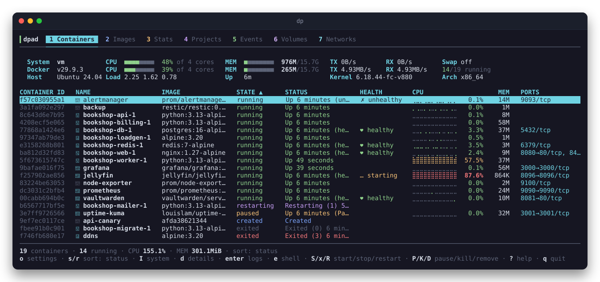

</div>

## Install

dpad needs a running Docker engine and the Docker CLI. Every method installs
both `dpad` and the short `dp` command. Pick one line:

| Platform | Method | Command |
| --- | --- | --- |
| macOS, Linux | [Homebrew](#homebrew) | `brew install spar/tap/dpad` |
| macOS, Linux, WSL2 | [Install script](#install-scripts) | `curl -fsSL https://dpad.sh/install \| sh` |
| Windows | [Scoop](#scoop) | `scoop bucket add spar https://github.com/spar/scoop-bucket; scoop install spar/dpad` |
| Windows | [PowerShell script](#install-scripts) | `irm https://dpad.sh/install.ps1 \| iex` |
| Any | [Release archive](#release-archives) or [source](#from-source) | see below |

Then run `dp`. To check the install, run `dp --version`.

### Homebrew

```sh
brew install spar/tap/dpad
```

Upgrade with `brew upgrade dpad`.

### Scoop

```powershell
scoop bucket add spar https://github.com/spar/scoop-bucket
scoop install spar/dpad
```

Upgrade with `scoop update dpad`.

### Install scripts

For machines without a package manager. Run the same command again to upgrade.
The scripts detect amd64 or arm64, check the download against the release's
SHA-256 checksum, and install for your user only.

```sh
# macOS, Linux or WSL2: installs into ~/.local/bin
curl -fsSL https://dpad.sh/install | sh
```

```powershell
# Windows PowerShell: installs into %LOCALAPPDATA%\Programs\dpad and adds it to your PATH
irm https://dpad.sh/install.ps1 | iex
```

`dpad.sh/install` and `dpad.sh/install.ps1` redirect to
[`scripts/install.sh`](scripts/install.sh) and
[`scripts/install.ps1`](scripts/install.ps1) in this repository, so you can
read them first. If your shell can't find `dp` after the macOS or Linux script,
add `export PATH="$HOME/.local/bin:$PATH"` to your shell profile.

### Release archives

Download the archive for your OS and CPU from
[GitHub Releases](https://github.com/spar/dpad/releases/latest)
(`.tar.gz` for macOS and Linux, `.zip` for Windows), check it against
`SHA256SUMS` and put the `dpad` binary on your PATH.

Releases also carry signed build provenance. With the GitHub CLI you can
check that an archive was built by this repository's release workflow:

```sh
gh attestation verify dpad-linux-amd64.tar.gz --repo spar/dpad
```

### From source

To build from source with **Go 1.26.7+**, run:

```sh
git clone https://github.com/spar/dpad.git
cd dpad
make install
```

Shell completion, other install locations and troubleshooting are covered in
[Running locally](docs/local-development.md).

## Quick start

```bash
dp                    # full-screen TUI
dp ps -a              # colored, sortable ps
dp stats --sort mem   # live stats, biggest memory users first
dp logs -f api worker # Compose services or containers, one stream
```

Want something to look at? `make demo-up` starts three demo Compose projects
(a web shop, a monitoring stack and a homelab, about 20 containers) that
exercise every feature (busy CPUs, memory near its limit, health checks,
crash loops, JSON and logfmt logs). `make demo-down` removes them.

## Why dp

`docker ps` and `docker stats` are fine for a quick look. Once you run more than
a handful of containers, you start piping through `grep`, opening one terminal
per `docker logs -f`, and re-running commands to see what changed. `dp` keeps
the commands you already know and fills those gaps:

| | `docker` | `dp` |
|---|:---:|:---:|
| Colored container states and a health column | | ✓ |
| Sort `ps`, `images` and `stats` by any column | | ✓ |
| Live CPU graph and memory on every running container in the list | | ✓ |
| CPU and memory bars, plus two-minute sparklines | | ✓ |
| Network and disk throughput per second | totals only | ✓ |
| Logs from several containers interleaved, with level highlighting | one container¹ | ✓ |
| Regex filter over buffered logs, with match highlighting | | ✓ |
| Compose projects: grouped stats, project logs, start/stop/restart, image updates | per project dir¹ | ✓ |
| Edit a Compose file, check it and review the diff before saving, also over SSH | | ✓ |
| Events timeline, volume and network usage, container shells | separate commands | ✓ in one UI |
| Prune with a list of exactly what will be removed | | ✓ |
| Your own commands on a key, mouse support | | ✓ |
| Every other command and flag | ✓ | ✓ passed through |

<sub>¹ `docker compose logs` and `docker compose up` cover one project at a time, from its directory.</sub>

`dp` talks to the Docker Engine API directly and uses your existing contexts and
`DOCKER_HOST`. Switching contexts inside `dp` does not change the Docker CLI's
saved current context.

## Features

### Live stats you can sort and read at a glance

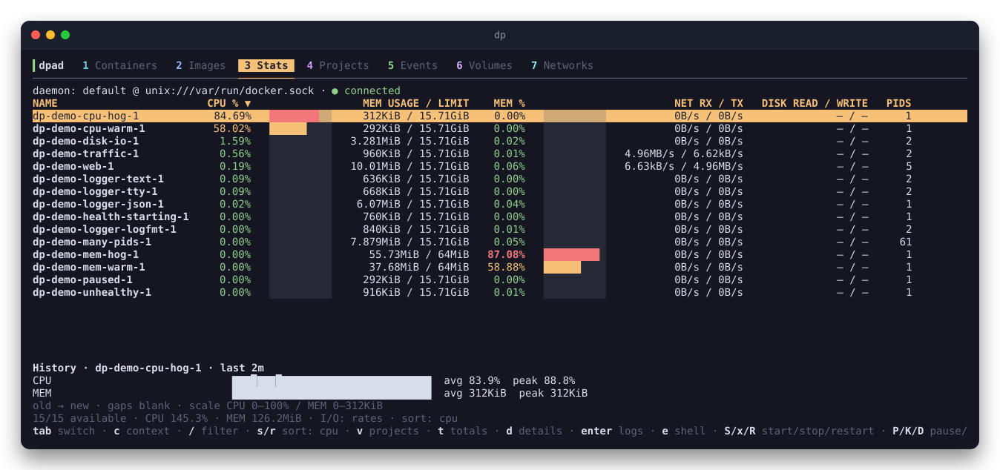

- CPU and memory bars that turn yellow and red as usage climbs.
- Network RX/TX and disk read/write as **rates per second**; press `t` for cumulative totals.
- Sort by CPU, memory, network, disk, PIDs or name with `s`, reverse with `r`.
- CPU and memory **sparklines** for the selected container, with average and peak over the last two minutes.
- Compose projects collapse into one summary row (`v` toggles the flat view).
- Streams that stall or drop reconnect on their own; stale values show `—` instead of old numbers.

### Logs from a whole project in one stream

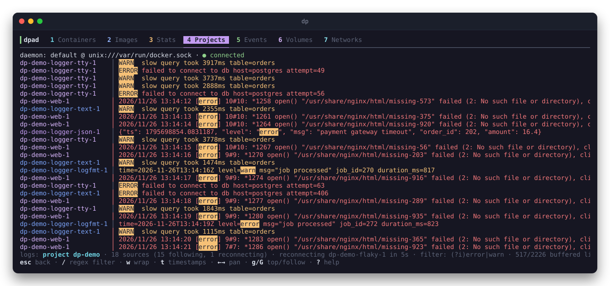

- Follow one container, several (`dp logs a b c`), or a whole Compose project (`enter` on a project row, or `dp logs <project>`).
- `dp logs` accepts container names and IDs, Compose service and project names, and unique name prefixes, so `dp logs web` works without typing `myapp-web-1`.
- Every container gets a stable color; stderr lines are marked with `┃`.
- Log levels are highlighted in plain text, JSON, logfmt and nginx formats.
- Press `/` to filter by regular expression. Matches are highlighted and new lines are filtered as they arrive.
- `w` wraps long lines and `t` shows timestamps.
- Project logs follow containers as they are scaled, recreated or restarted, and resume from the last timestamp after a reconnect.

### Everything else in one place

<table>
  <tr>
    <td width="50%" valign="top">
      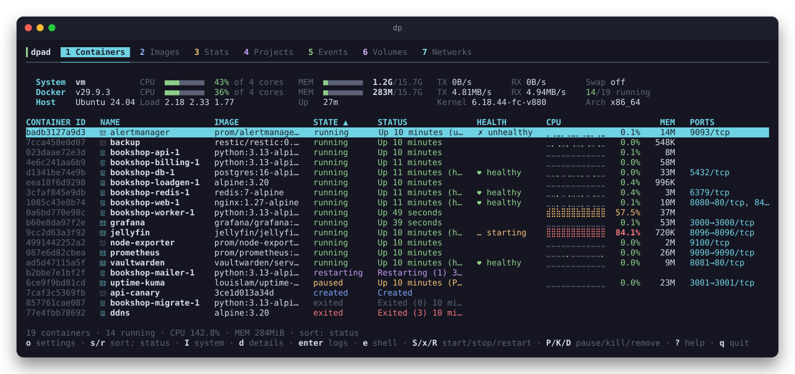<br>
      <b>Containers</b><br>
      <sub>States, health and ports in color, with a live CPU graph and memory for each running container. Start, stop, restart, pause, kill and remove with a confirmation; <code>e</code> opens a shell.</sub>
    </td>
    <td width="50%" valign="top">
      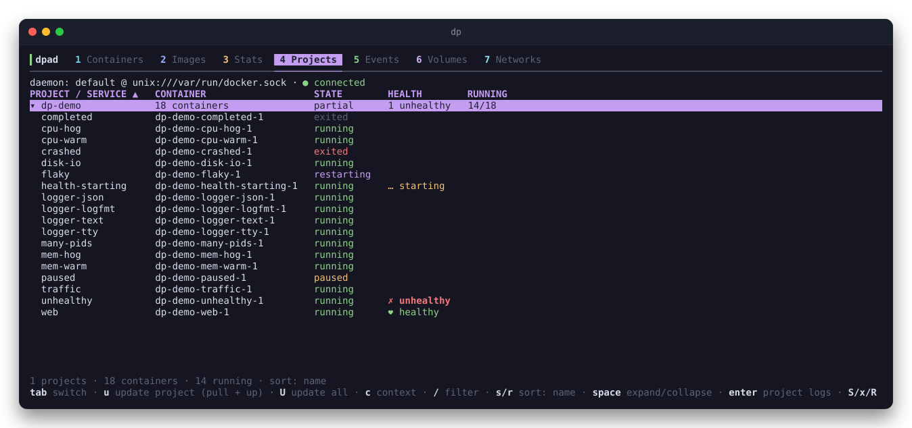<br>
      <b>Compose projects</b><br>
      <sub>Grouped by project and service, with running and unhealthy counts. <code>u</code> previews and runs <code>pull</code> + <code>up -d</code>.</sub>
    </td>
  </tr>
  <tr>
    <td width="50%" valign="top">
      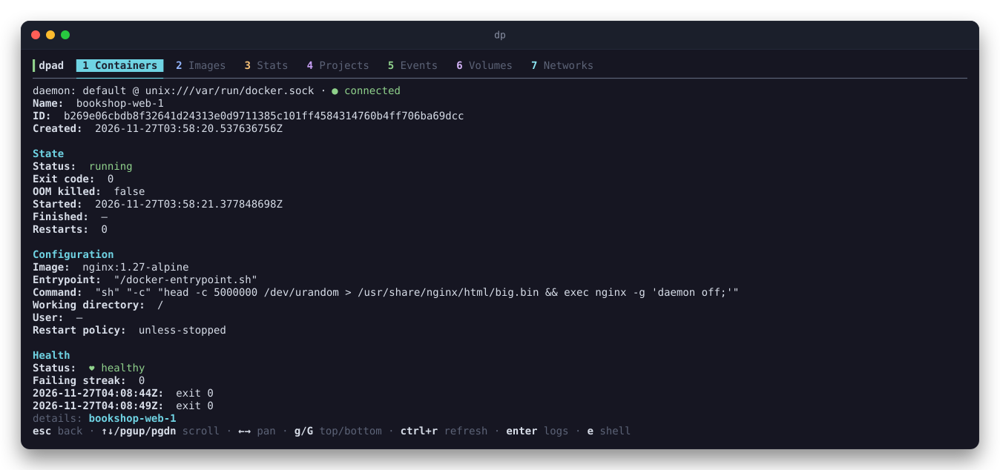<br>
      <b>Details</b><br>
      <sub>State, exit code, OOM status, restart policy, health checks, ports, networks and mounts. Environment variables are left out.</sub>
    </td>
    <td width="50%" valign="top">
      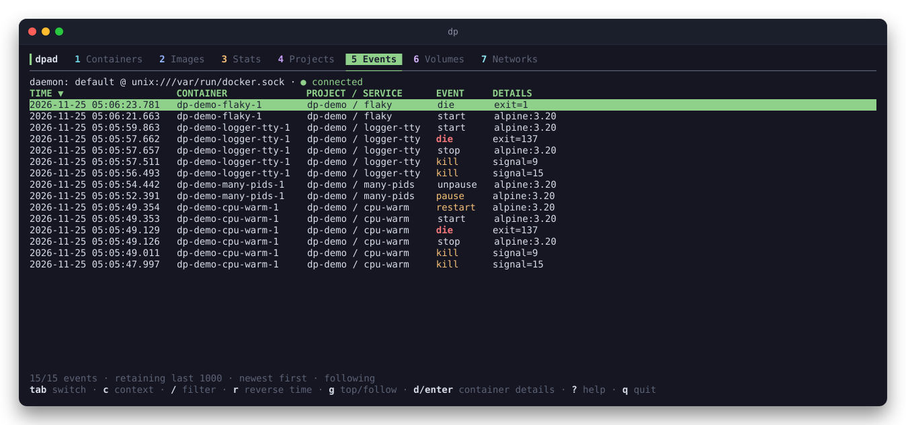<br>
      <b>Events</b><br>
      <sub>A live timeline of lifecycle and health events, filterable by container, project, service or event type.</sub>
    </td>
  </tr>
  <tr>
    <td width="50%" valign="top">
      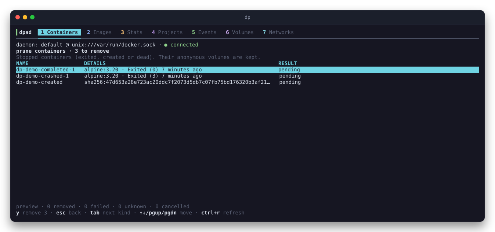<br>
      <b>Prune</b><br>
      <sub><code>X</code> lists the stopped containers, unused images, volumes, networks or build cache a prune would remove, then removes exactly those after <code>y</code>.</sub>
    </td>
    <td width="50%" valign="top">
      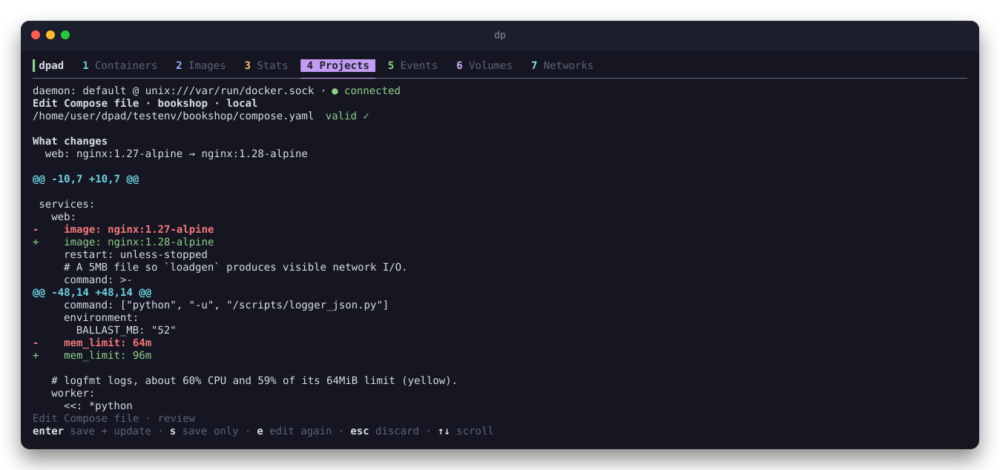<br>
      <b>Edit Compose files</b><br>
      <sub><code>e</code> on a project opens its Compose file in the built-in editor, with YAML colors, find and go to line, or in your own editor. dpad checks the result with <code>docker compose config</code>, shows what changes and a diff, then saves it and can go straight on to an update. Works for projects on an SSH host too.</sub>
    </td>
  </tr>
  <tr>
    <td width="50%" valign="top">
      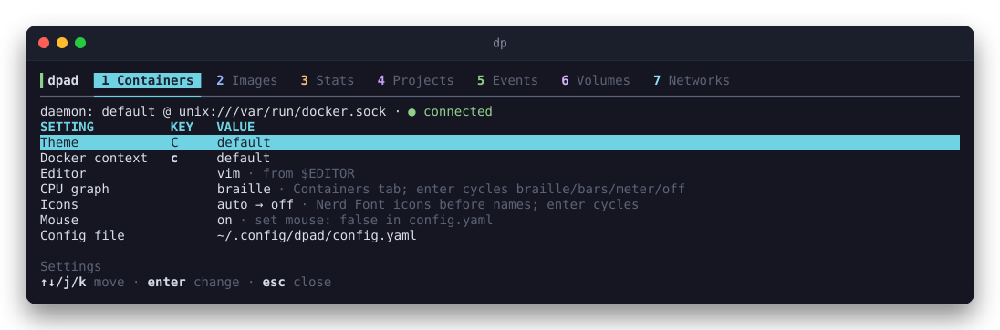<br>
      <b>Settings</b><br>
      <sub><code>o</code> lists the theme, Docker context, editor, CPU graph style (braille, bars, meter or off), icons, mouse setting and config file. <code>enter</code> on a row opens its picker or cycles the graph style or icon mode. Theme, editor, graph style and icons are saved to <code>config.yaml</code>; a context choice lasts for the session.</sub>
    </td>
    <td width="50%" valign="top">
      <b>Custom commands and mouse</b><br>
      <sub>Bind your own commands to keys in <code>~/.config/dpad/config.yaml</code>, run against the selected container or Compose project. Click tabs and rows, double-click to open, scroll with the wheel. See <a href="docs/usage.md#custom-commands">Custom commands</a>.</sub>
    </td>
  </tr>
</table>

The **Images**, **Volumes** and **Networks** tabs show which containers, running
or stopped, use each image, volume or network. Press `c` to switch to another
Docker context for the current session.

### A better `docker` for everyday commands

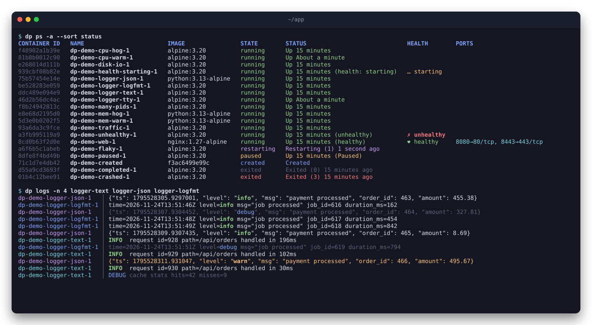

The CLI commands keep Docker's flags and add sorting and color. Output stays plain
when piped, when `NO_COLOR` is set, or with `--no-color`, so scripts keep working.

### Remote daemons over SSH

```bash
DOCKER_HOST=ssh://me@server dp
```

`dp` opens one SSH tunnel to the remote socket and draws the UI locally, so
moving through lists doesn't wait on the network. Your `~/.ssh/config`, agent and
known hosts apply, rootless sockets work (`ssh://me@server/run/user/1000/docker.sock`),
dropped connections reconnect in the background, and `e` edits a project's
Compose file on the server through the same connection. Details are in
[Daemon connection](docs/usage.md#daemon-connection).

### Themes

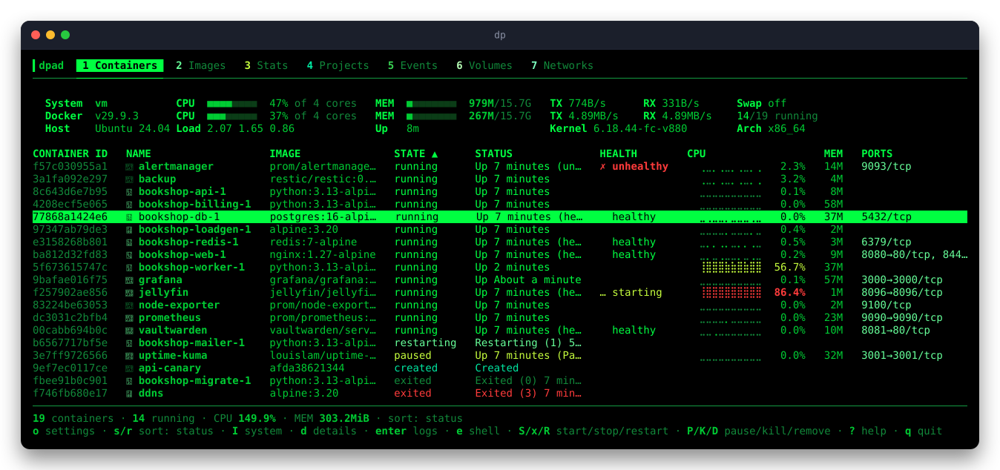

dpad ships eleven color themes, from the default that follows your terminal's
palette to matrix, amber CRT, black and white, high contrast and two light
themes, including ink, black on white like an e-ink screen.
Press `C` (or open settings with `o`) to preview them live and save your pick, or set `theme: matrix` in `config.yaml`. A
theme is one YAML file, so you can write your own or contribute one. See the
[gallery and theme guide](docs/themes.md).

<sub>All screenshots are real, unedited output from the bundled demo environment (`make demo-up`), captured with `make screenshots`.</sub>

## Commands

| Command | What it adds over docker |
|---|---|
| `dp` | Full-screen TUI: Containers, Images, Stats, Projects, Events, Volumes and Networks tabs, with filtering, details, logs, shells and confirmed actions |
| `dp ps [-a] [-f name=value...] [--sort name\|created\|status] [-r]` | State colors (running, exited ok/error, paused, restarting), a health badge, and compact `8080→80/tcp` ports |
| `dp images [--sort size\|created\|name] [-r]` | Human sizes and a total-size footer; dangling images are dimmed |
| `dp stats [--sort cpu\|mem\|net\|io\|pids\|name] [-r] [--no-stream] [--totals]` | Live sorting, CPU/memory bars, network/disk throughput; `t` toggles rates and totals |
| `dp themes` | Lists the color themes with a swatch of each; pick one with `--theme`, `DPAD_THEME` or `theme:` in `config.yaml` |
| `dp logs [-f] [-n N] [-t] [--since T] [--grep RE] TARGET...` | Accepts containers, Compose services and projects, and unique name prefixes. Interleaves containers with colored name prefixes, highlights log levels, marks stderr with `┃`, highlights `--grep` matches |

Sorts default to the natural direction for each key: biggest first for numbers,
A to Z for names. `-r` reverses.

**Passthrough.** These go to `docker` unchanged, so you can type `dp` wherever you
would type `docker`:

- Commands `dp` doesn't implement: `dp network ls`, `dp exec -it web sh`
- Flags `dp` doesn't implement: `dp ps --format '{{.Names}}'`, `dp ps -q`
- Docker global flags: `dp --context prod ps`
- `dp stats web db`, because docker already handles selecting containers

### Main TUI keys

| Key | Action |
|---|---|
| `tab` / `1`–`7` | switch tab |
| `↑↓` `j k` `pgup pgdn` `g G` | move |
| `/` | filter the current tab |
| `s` / `r` | cycle sort key / reverse |
| `enter` | follow logs of the selected container or Compose project |
| `d` | details |
| `e` | open a shell in the container |
| `S` / `x` / `R` | start / stop / restart, after a `y/N` confirmation |
| `P` / `K` / `D` | pause / kill / remove (`S` resumes a paused container) |
| `e` on a project | edit its Compose file in the built-in editor or your own, check it, then save and update (Projects tab) |
| `D` on a project | preview and run `docker compose down`, keeping volumes unless you press `v` (Projects tab) |
| `u` / `U` | update the selected / all Compose projects: `pull`, then `up -d`, with live progress (Projects tab) |
| `c` | choose a Docker context |
| `C` | choose a color theme, previewed live |
| `o` | settings: theme, Docker context, editor, CPU graph style, icons, mouse, config file location |
| `?` | help for the current view |

The full key list and the behavior of each tab are in [docs/usage.md](docs/usage.md).

## Performance

`dp` is built to stay responsive with hundreds of containers and to cost little
while it sits open in a terminal tab.

**How it stays light**

- One Docker event subscription drives the container lists, Projects and the Events timeline. Bursts of events are coalesced into at most one list refresh per second.
- Stats updates are batched before redrawing. Project grouping, rates and sparklines are computed from the same stream and add no Docker requests.
- Buffers have fixed limits: 5,000 log lines, 1,000 events, and 120 one-second history buckets (about 6 KiB) per container.
- The TUI renders at up to 120 frames per second, and frames that haven't changed write nothing. Over SSH, event and log redraws are batched further.

**Measured with the 19-container demo running**

| | Result |
|---|---|
| Binary | 11.7 MiB on linux/amd64, static and stripped (`CGO_ENABLED=0`) |
| Memory | about 27 MB resident with the TUI open and live stats streaming |
| CPU | about 2% of one core in the same state (30-second average) |
| `dp ps -a` | 115 to 118 ms, against 141 to 147 ms for `docker ps -a` (mean of 50 runs) |
| `dp images` | 100 to 102 ms, against 111 to 115 ms for `docker images` (mean of 50 runs) |

**Microbenchmarks with 1,000 containers** (`go test -bench`)

| Operation | Time per op |
|---|---|
| Move the selection and redraw the Containers tab (140×40 terminal) | 0.25 ms |
| Move the selection and redraw the Projects tab (100 projects) | 0.24 ms |
| Redraw the Stats tab | 0.07 ms |
| Apply a stats batch for 1,000 containers, then redraw (100 collapsed projects) | 3.3 ms |
| Apply a stats batch for 1,000 containers, then redraw (flat view) | 24 ms |
| Record one sparkline sample | 22 ns, 0 allocations |
| Compute network and disk rates for one sample | 53 ns, 0 allocations |

<sub>Measured on a 4-vCPU Intel Xeon @ 2.10 GHz Linux VM with Docker Engine 29.9 and Go 1.26.11, on 26 November 2026. Your numbers will differ; reproduce the benchmarks with
<code>go test -run '^$' -bench . -benchmem ./internal/...</code>.</sub>

## Compared with other tools

[lazydocker](https://github.com/jesseduffield/lazydocker),
[dry](https://github.com/moncho/dry), [ctop](https://github.com/bcicen/ctop),
[oxker](https://github.com/mrjackwills/oxker) and
[dtop](https://github.com/amir20/dtop) are all good terminal tools for Docker.
This table covers where they differ from `dp`:

| | dpad | lazydocker | dry | ctop | oxker | dtop |
|---|:---:|:---:|:---:|:---:|:---:|:---:|
| Also replaces `docker` commands in the shell | ✓ | | | | | |
| Compose projects view | ✓ | ✓ | ✓ | | | column only |
| Logs from several containers in one stream | any mix of containers, services and projects | per service or project | per service or project | | | |
| Search or filter logs | live regex filter | | search | | search | |
| Events timeline | ✓ filterable | | last 10 events | | | |
| Prune | ✓ with a preview | ✓ | ✓ | | | |
| Custom commands | ✓ | ✓ | | | | |
| Several hosts in one view | | | | | | ✓ |
| Docker Swarm | | | ✓ | | | |

<sub>Based on each project's README and docs as of 24 November 2026. An empty cell means the feature isn't documented there, not that it can't be done another way.</sub>

Each of them also does things `dp` doesn't. lazydocker has the largest community
and shows image layer history. dry manages Swarm and detects Compose drift. dtop
watches several hosts in one table. ctop is a minimal `top` for containers, though
it hasn't had a commit since July 2024. More tools are listed in
[Awesome Docker](https://github.com/veggiemonk/awesome-docker#terminal).

## Documentation

- **[Using dpad](docs/usage.md):** every tab, key and action, Compose updates, stats details, contexts and SSH.
- **[Themes](docs/themes.md):** the built-in themes, choosing one, writing your own, and the theme file format.
- **[Running locally](docs/local-development.md):** prerequisites for macOS, Linux and Windows, building, installing, troubleshooting.
- **[Demo environment](testenv/README.md):** what each demo container shows, plus a guided feature tour.
- **[Self-hosted CI runners](docs/self-hosted-runner.md):** running CI on your own Docker hosts with the shared runners from gh-private-runners.
- **[Package managers](docs/package-managers.md):** how releases update the Homebrew tap and Scoop bucket (and the AUR package once it is set up), and their one-time setup.

## Contributing

Issues and pull requests are welcome. Before opening a pull request:

```bash
make test vet lint
```

Tests use fakes rather than a live Docker daemon, so they run anywhere. Commit
messages follow [Conventional Commits](https://www.conventionalcommits.org/)
(`fix(stats): ...`, `feat(tui): ...`). [CONTRIBUTING.md](CONTRIBUTING.md) has
the checklist, including how to add a theme, and [AGENTS.md](AGENTS.md)
describes the code layout and conventions in more detail.

| Path | Contents |
|---|---|
| `cmd/` | cobra commands and passthrough routing |
| `internal/docker/` | Engine API client, contexts, stats math, events, log streaming |
| `internal/render/` | styles from the active theme, ANSI-aware table, formatters, log-level highlighting |
| `internal/theme/` | loads and validates theme files |
| `themes/` | the built-in themes, one YAML file each |
| `internal/tui/` | the Bubble Tea app and its views |
| `testenv/` | demo Compose environment |
| `scripts/screenshots/` | regenerates the README images from the demo environment |

## Sponsoring

If dpad saves you time, you can support its development through
[GitHub Sponsors](https://github.com/sponsors/spar).

## Acknowledgements

`dp` is built on [Bubble Tea](https://github.com/charmbracelet/bubbletea),
[Bubbles](https://github.com/charmbracelet/bubbles) and
[Lip Gloss](https://github.com/charmbracelet/lipgloss) from Charm,
[Cobra](https://github.com/spf13/cobra), and the
[Moby](https://github.com/moby/moby) Engine API client.

## License

dpad is free software under the [GNU General Public License v3.0](LICENSE)
(GPL-3.0-only), with the attribution and naming terms in [NOTICE](NOTICE). You
can use, modify, fork and sell it, but anything you distribute that is based on
dpad must be released under the same license with its source, keep the
attribution, and use a different name. Earlier versions were published under
the MIT License.
