# Themes

A theme sets every color dpad draws with: the tab accents, container states,
health badges, CPU and memory bars, sparklines, log levels, the selected row
and the terminal background while the TUI runs. dpad ships eleven themes, and you
can write your own in a few lines of YAML.

- [Choosing a theme](#choosing-a-theme)
- [Gallery](#gallery)
- [Writing your own](#writing-your-own)
- [Theme file reference](#theme-file-reference)
- [Color values](#color-values)
- [Terminals with fewer colors, and NO_COLOR](#terminals-with-fewer-colors-and-no_color)
- [Adding a theme to dpad](#adding-a-theme-to-dpad)

## Choosing a theme

Press `C` in the TUI, or choose Theme in the settings screen (`o`), to open
the theme picker. Moving through the list previews each theme on the whole
screen; `enter` keeps it and saves it as `theme:` in your `config.yaml`, and
`esc` goes back to the theme you had.

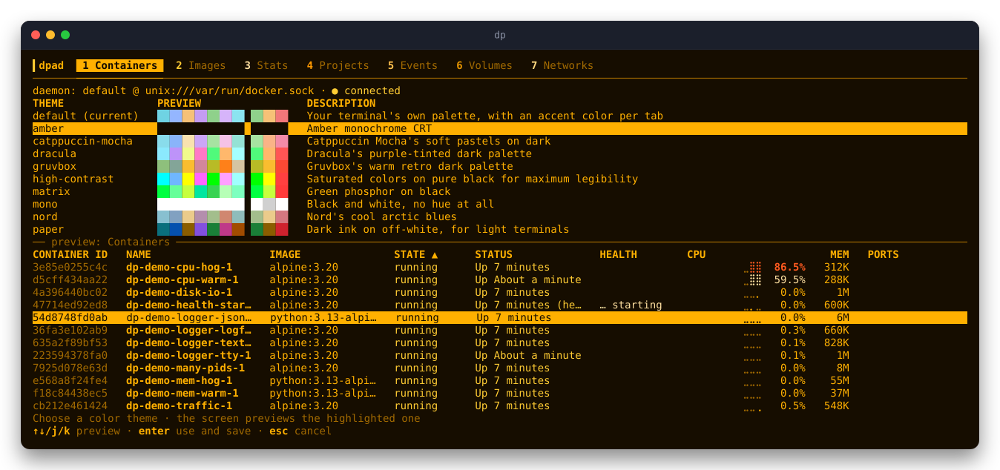

The picker only changes the `theme:` line, creating `config.yaml` if needed,
and leaves the rest of the file as you wrote it. You can also set the theme
there yourself, in `~/.config/dpad/config.yaml` (the same file as
[custom commands](usage.md#custom-commands)):

```yaml
theme: matrix
```

The `--theme` flag and the `DPAD_THEME` environment variable override the
file, for one run or one shell:

```bash
dp --theme amber
DPAD_THEME=nord dp ps
```

`dp themes` lists every theme with a swatch of its colors and marks the active
one. Themes apply to the CLI commands (`dp ps`, `dp images`, `dp stats`,
`dp logs`) as well as the TUI. The CLI only changes text colors, so the
terminal keeps its own background there.

If a theme can't be loaded, dpad says why (in the status line, or on stderr for
CLI commands) and uses the default theme.

## Gallery

All images show the Containers tab of the [demo environment](../testenv/README.md).

<table>
  <tr>
    <td width="50%" valign="top">
      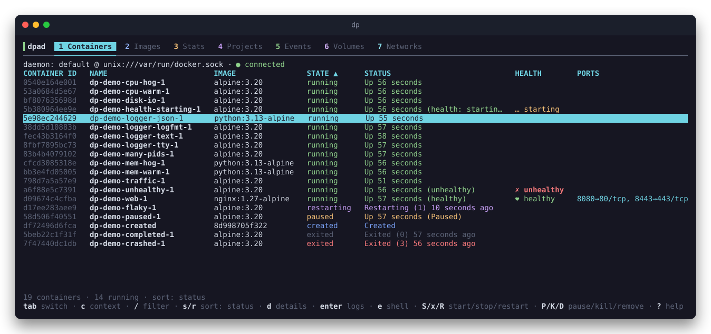<br>
      <b>default</b>: your terminal's own palette, with an accent color per tab
    </td>
    <td width="50%" valign="top">
      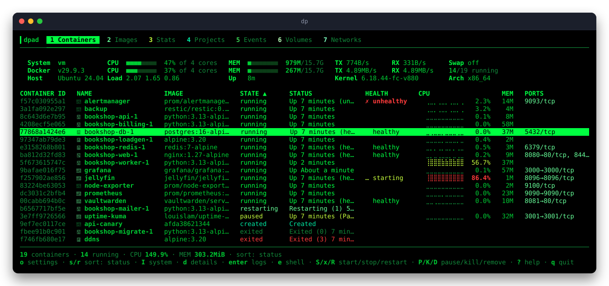<br>
      <b>matrix</b>: green phosphor on black
    </td>
  </tr>
  <tr>
    <td width="50%" valign="top">
      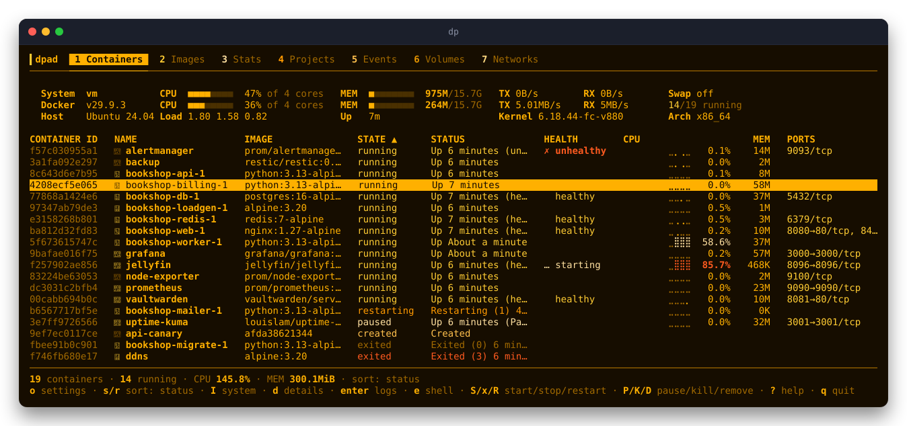<br>
      <b>amber</b>: an amber monochrome CRT
    </td>
    <td width="50%" valign="top">
      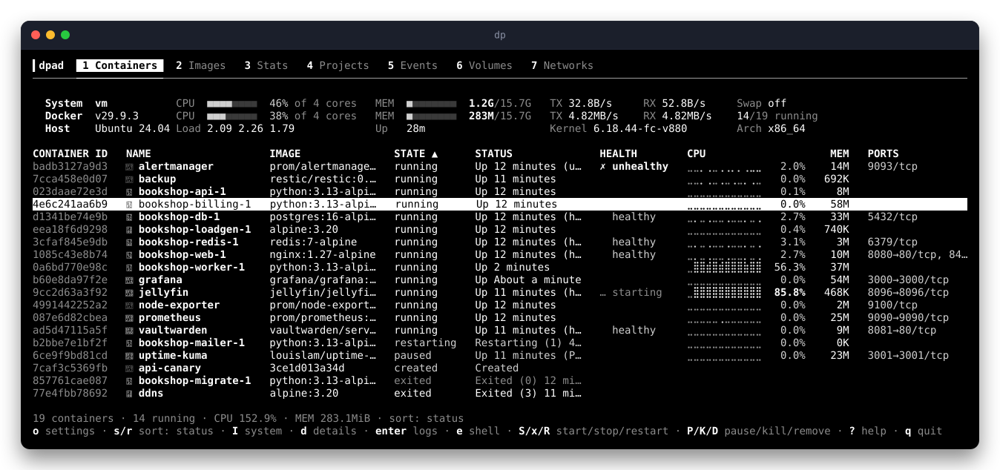<br>
      <b>mono</b>: black and white, no hue at all
    </td>
  </tr>
  <tr>
    <td width="50%" valign="top">
      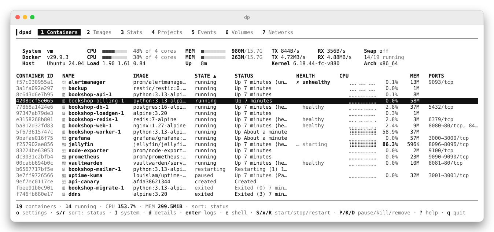<br>
      <b>ink</b>: black ink on white, like an e-ink screen
    </td>
    <td width="50%" valign="top">
      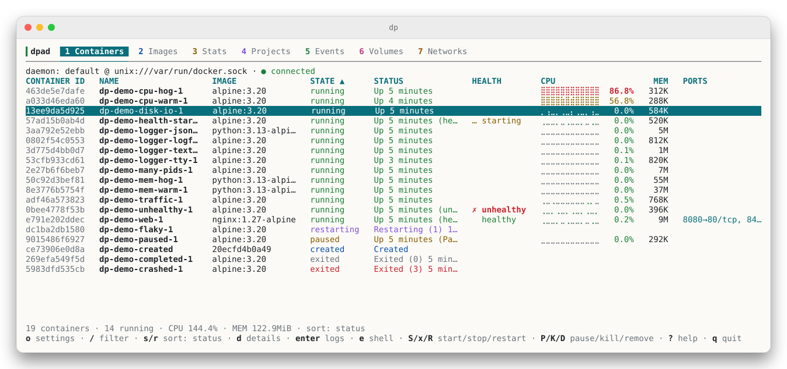<br>
      <b>paper</b>: dark ink on off-white, for light terminals
    </td>
  </tr>
  <tr>
    <td width="50%" valign="top">
      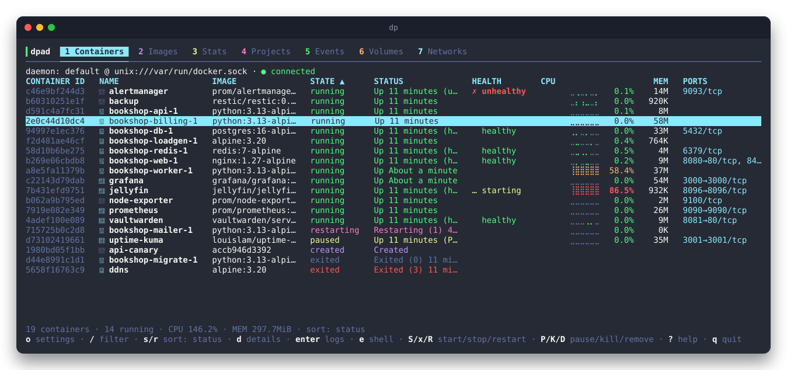<br>
      <b>dracula</b>: the <a href="https://draculatheme.com">Dracula</a> palette
    </td>
    <td width="50%" valign="top">
      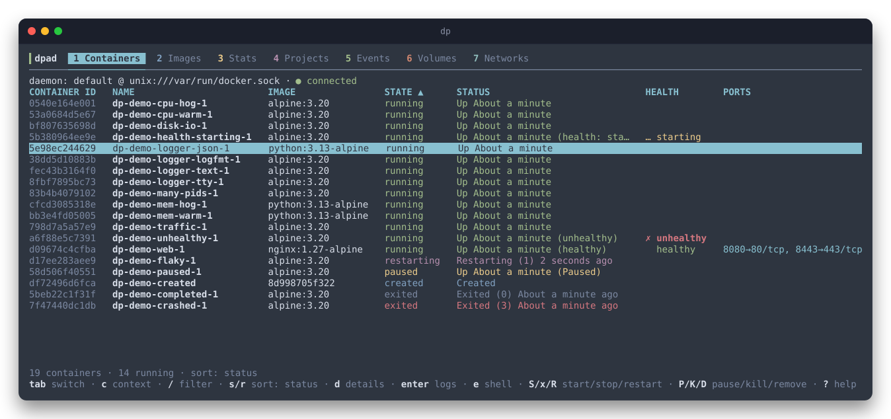<br>
      <b>nord</b>: the <a href="https://www.nordtheme.com">Nord</a> palette
    </td>
  </tr>
  <tr>
    <td width="50%" valign="top">
      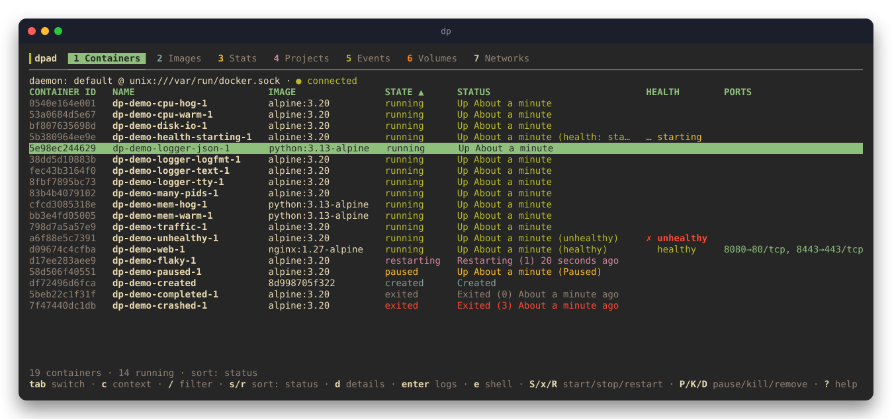<br>
      <b>gruvbox</b>: the <a href="https://github.com/morhetz/gruvbox">gruvbox</a> dark palette
    </td>
    <td width="50%" valign="top">
      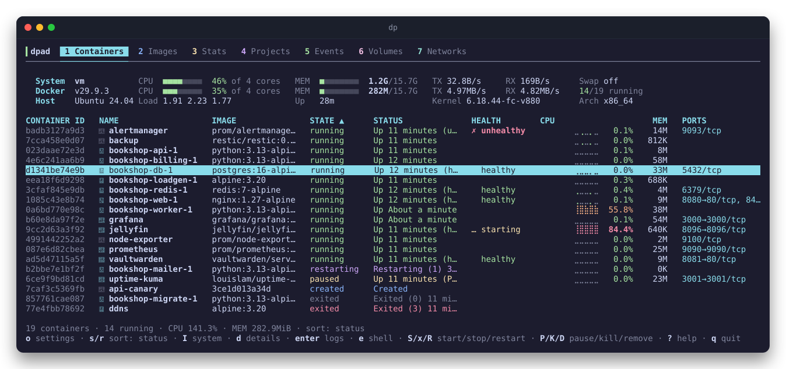<br>
      <b>catppuccin-mocha</b>: the <a href="https://catppuccin.com">Catppuccin</a> Mocha palette
    </td>
  </tr>
  <tr>
    <td width="50%" valign="top">
      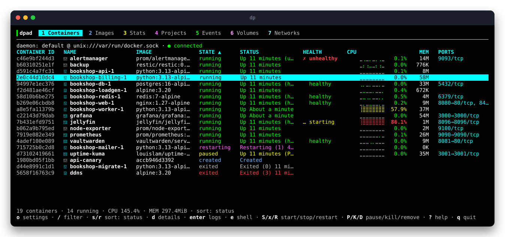<br>
      <b>high-contrast</b>: saturated colors on pure black
    </td>
    <td width="50%" valign="top"></td>
  </tr>
</table>

## Writing your own

Put a `.yaml` file in `~/.config/dpad/themes/` (next to `config.yaml`; with
`DPAD_CONFIG` set, the `themes` folder next to that file). Its file name is the
theme's name, so `~/.config/dpad/themes/midnight.yaml` is chosen with
`theme: midnight`. It shows up in `dp themes` and the picker.

A theme only needs the colors it changes. Everything else comes from the theme
it `extends`, or from `default` when it doesn't say:

```yaml
# ~/.config/dpad/themes/midnight.yaml
description: Nord, with a darker background and red tabs for production
extends: nord

terminal:
  background: "#1b1f27"

tabs:
  containers: "#d57780"
```

A file in your themes folder with the same name as a built-in theme replaces
it; it can still start from the built-in one with `extends` set to its own
name. To try a file without installing it, pass its path:
`dp --theme ./midnight.yaml`.

## Theme file reference

Every role, with the default theme's value. In the TUI, the active tab's color
replaces `ui.header` for table headers and colors the selected row.

```yaml
name: default          # optional; must match the file name
description: Your terminal's own palette, with an accent color per tab
author: dpad           # optional
source: ""             # optional: where a palette comes from
extends: default       # optional: the theme to take missing roles from

terminal:              # the terminal's own colors while the TUI runs
  background: default  # default leaves the terminal as it is
  foreground: default

ui:
  brand: green         # the ▍ mark before "dpad"
  dim: bright-black    # secondary text: IDs, hints, the status line
  header: blue         # table headers in CLI output
  accent: cyan         # names in status lines, work in progress
  success: green       # connected, finished, ✓ marks
  warning: yellow      # confirmations, reconnecting, warnings
  error: red           # errors (drawn bold)
  onAccent: black      # text on the active tab and the selected row
  matchText: black     # dp logs --grep and logs-view filter matches
  matchBackground: yellow

tabs:                  # each tab's accent: tab bar, underline, headers, selection
                       # (default marks the active tab and selection in reverse video)
  containers: cyan
  images: bright-blue
  stats: yellow
  projects: magenta
  events: green
  volumes: bright-magenta
  networks: bright-cyan

states:                # container state and status text
  running: green
  exited: bright-black # exited with code 0
  failed: red          # exited with any other code
  paused: yellow
  restarting: magenta
  created: blue
  dead: red

health:
  healthy: green
  unhealthy: red
  starting: yellow

usage:                 # CPU and memory percentages and bars
  low: green           # under 50%
  medium: yellow       # under 80%
  high: red            # 80% and over (drawn bold)
  track: bright-black  # the empty part of a bar
  sparkline: default   # Stats history sparklines

logs:                  # log level keywords, and the text of error and warn lines
  error: red           # also the ┃ that marks stderr
  warn: yellow
  info: green
  debug: blue

columns:
  ports: cyan          # the PORTS column
  tag: yellow          # image tags

# Colors for container names in merged logs, handed out in order.
names: [cyan, magenta, blue, yellow, green, bright-cyan, bright-magenta, bright-blue, bright-yellow, bright-green]
```

A misspelled key is an error rather than being ignored, so a typo can't
silently leave a color unchanged.

## Color values

| Value | Meaning |
|---|---|
| `default` | the terminal's own foreground or background |
| `black` `red` `green` `yellow` `blue` `magenta` `cyan` `white` | the terminal's ANSI colors 0 to 7 |
| `bright-black` (or `gray`) ... `bright-white` | ANSI colors 8 to 15 |
| `0` to `255` | the xterm 256-color palette |
| `"#00ff41"`, `"#0f4"` | an exact RGB color |

Quote hex colors: YAML treats an unquoted `#` as the start of a comment, and
dpad reports a key left without a value.

ANSI names and numbers follow whatever palette the terminal uses, which is why
the default theme fits any terminal. Hex colors look the same everywhere, so a
theme built from them should set `terminal.background` too, or it may end up
dark text on a dark terminal.

## Terminals with fewer colors, and NO_COLOR

dpad detects what the terminal supports. On a 256-color or 16-color terminal,
hex colors are mapped to the nearest color the terminal has, so every theme
still works, with less exact shades. `terminal.background` and
`terminal.foreground` are sent with the standard OSC 10 and 11 sequences;
terminals that ignore them keep their own background, and dpad restores the
original colors when it exits.

With `NO_COLOR` set or `--no-color`, themes don't apply: output has no color,
and the TUI marks the active tab and the selected row in reverse video.

## Adding a theme to dpad

Built-in themes live in [`themes/`](../themes), one YAML file each, and are
compiled into the binary. To add one:

1. Copy a theme close to what you want, such as `themes/dracula.yaml`, to
   `themes/<name>.yaml`. Use lowercase letters, digits and dashes for the name.
2. Set `name` to the file name, write a short `description`, and add `source`
   if the colors come from an existing palette. Only palettes whose license
   allows reuse (for example MIT) can be included.
3. Set every role. Built-in themes don't use `extends`, so later changes to
   the default theme can't change them.
4. Try it: `make build && ./bin/dpad --theme <name>`, and `make demo-up` for
   realistic data.
5. Run `make test`. [`internal/theme/theme_test.go`](../internal/theme/theme_test.go)
   checks every theme file: it must parse, set every role, use valid colors,
   and, for themes that set a hex background, keep text readable (a contrast
   ratio of at least 4 for text and 3 for secondary text, with
   `ui.onAccent` readable on every tab color).
6. Add a step for the theme to `scripts/screenshots/themes.json`, in the
   picker's alphabetical order. With the demo environment running,
   `make screenshots` regenerates the gallery, including
   `docs/images/themes/<name>.svg`, and `make website` copies it to the
   website. Add your theme to the gallery table above.

See [CONTRIBUTING.md](../CONTRIBUTING.md) for the rest of the pull request
checklist.
